<p align="center">
  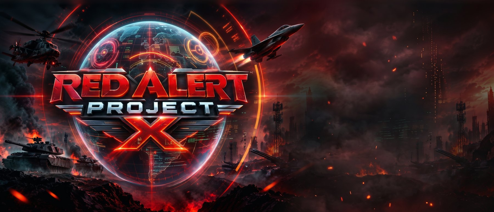
</p>

<h3 align="center">The Red Alert you remember, rebuilt as a modern HD real-time strategy game.</h3>

<p align="center">
  <a href="#-pilot-version-tell-us-what-you-think"></a>
  <a href="#-get-in-the-fight"></a>
  
  
  <a href="https://www.openra.net"></a>
</p>

<p align="center">
  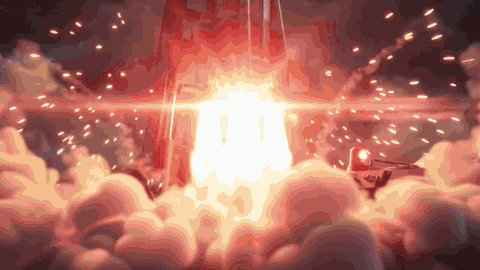
  <br><sub>Scenes from the game's cinematic intro</sub>
</p>

> [!IMPORTANT]
> **This is a pilot version.** Project X is in early access: expect rough edges, missing pieces and the
> occasional bug, and expect things to change between updates. Your feedback decides what gets fixed and built
> next, so [tell us what you think](#-pilot-version-tell-us-what-you-think).

---

## ☢️ The world is on alert

Two superpowers. Sixteen nations. One battlefield.

The **Union** and the **Vanguard** are at war, and you command one of them. Build your base, harvest ore, raise an
army of tanks, jets, warships and battle robots, then bring it all down on your enemy before they launch first.

**Project X** keeps the fast, classic base-building of Command & Conquer: Red Alert and gives it everything a
modern RTS should have: hand-rendered 3D units, a full HD interface, living weather, superweapons and a cinematic
intro. It is **free**, runs **offline**, and needs **no original game files**.

<p align="center">
  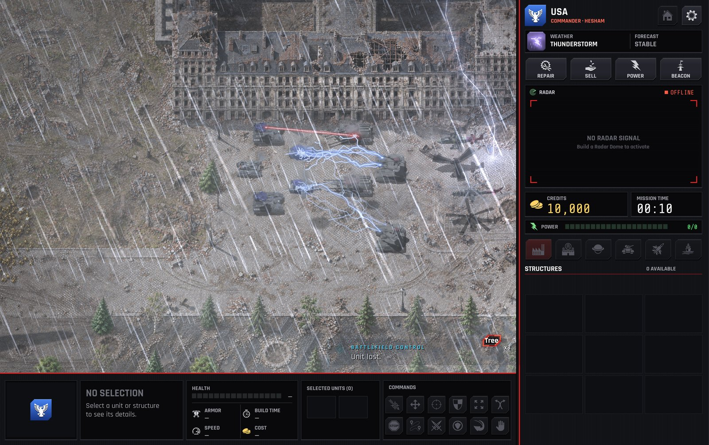
  <br><sub>Berlin 1946, thunderstorm: Prism lasers and Tesla lightning in front of the ruined palace</sub>
</p>

## 🎖️ What's inside

<table>
  <tr>
    <td width="50%" valign="top">
      <h3>🛩️ HD 3D-rendered armies</h3>
      Every tank, jet, helicopter, warship, soldier and building is rendered from a real 3D model, with
      national building styles, smooth motion and HD explosions, smoke and missile trails.
    </td>
    <td width="50%" valign="top">
      <h3>🌍 16 nations, 2 superpowers</h3>
      Pick from the USA, England, France, Germany, Japan, South Korea, Italy and Egypt in the
      <b>Union</b>, or Russia, Ukraine, Cuba, India, China, Turkey, Pakistan and Iran in the <b>Vanguard</b>.
      Nations bring their own exclusive units.
    </td>
  </tr>
  <tr>
    <td valign="top">
      <h3>✈️ A real air force</h3>
      Airfields with parking slots, jets that rearm on the pad, layered air defence, flares, real missile
      models and bombers. Helicopters reload in the field.
    </td>
    <td valign="top">
      <h3>🤖 Battle robots</h3>
      Cyborg Troopers, Battle Droids, Railgun Robots, Iron Guards and Tesla Automatons take the field
      next to classic infantry.
    </td>
  </tr>
  <tr>
    <td valign="top">
      <h3>☢️ Superweapons</h3>
      Nuclear Missile Silos, the USA's Fatman Strike from its bomber field, ASAT sites and more. Watch the
      sky.
    </td>
    <td valign="top">
      <h3>🌨️ Living weather</h3>
      Thunderstorms, rain, snow, blizzards, sandstorms, fog and strong winds roll across the map during
      battle, with a forecast in your sidebar.
    </td>
  </tr>
  <tr>
    <td valign="top">
      <h3>🖥️ A modern interface</h3>
      Fully reskinned menus, lobby and sidebar, production tabs, hologram building placement, detailed unit
      cards, a battle report and an observer view with live player stats. RA2-style controls available.
    </td>
    <td valign="top">
      <h3>📖 Arsenal Catalogue</h3>
      Browse every nation's units and buildings in <b>Extras</b>, with 3D previews, stats, weapons and
      field dossiers.
    </td>
  </tr>
</table>

## ⛈️ Every map, every weather

<table>
  <tr>
    <td width="50%">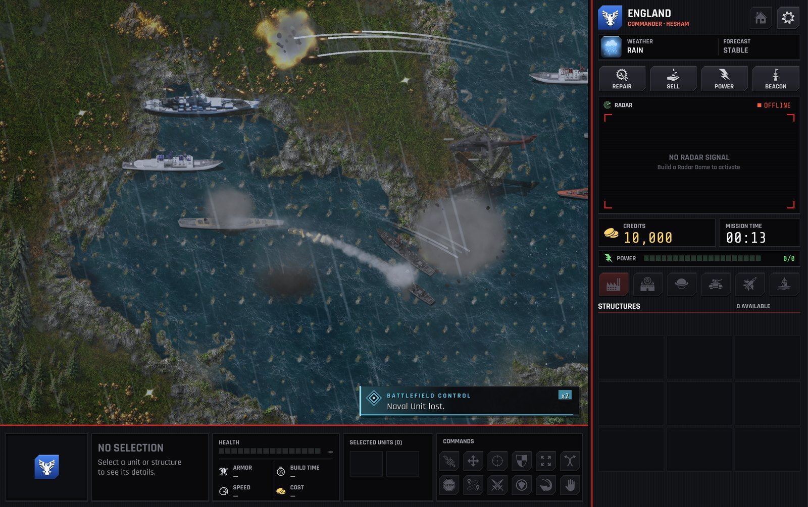</td>
    <td width="50%">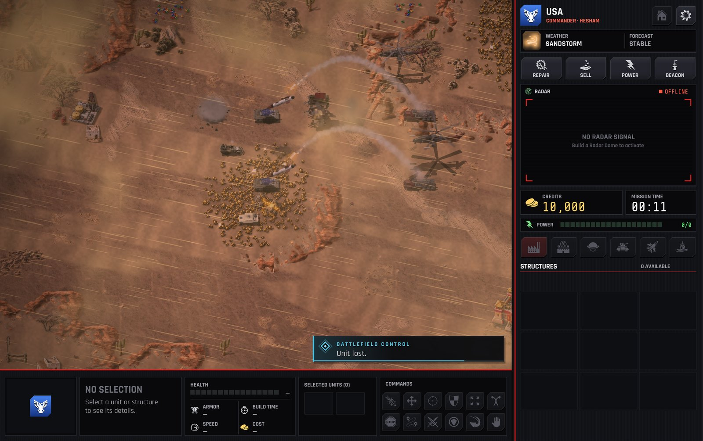</td>
  </tr>
  <tr>
    <td align="center"><sub>Archipelago, rain: battleships and missile cruisers duel in the lagoon</sub></td>
    <td align="center"><sub>Desert Rats, sandstorm: Hinds rocket a tank column</sub></td>
  </tr>
  <tr>
    <td>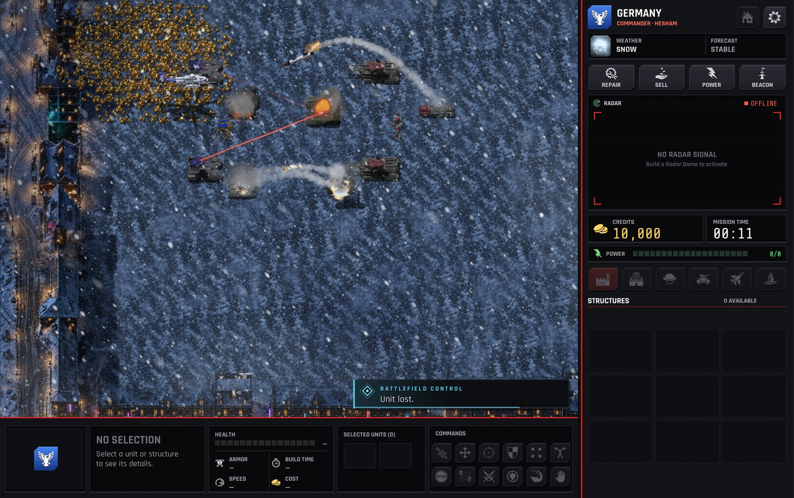</td>
    <td>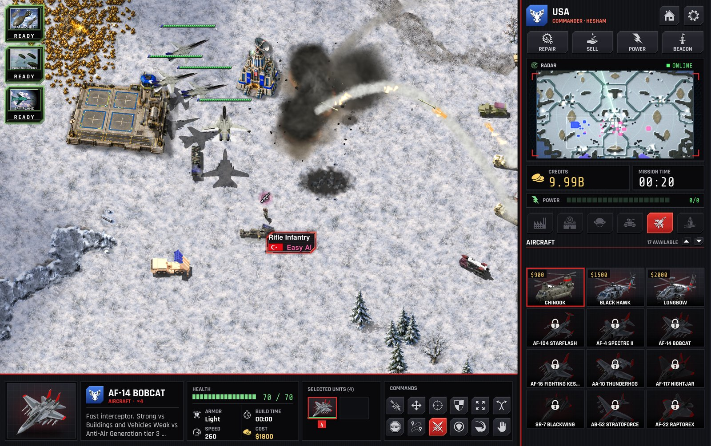</td>
  </tr>
  <tr>
    <td align="center"><sub>Ironward, snow: a night battle at the city's edge</sub></td>
    <td align="center"><sub>Jets scramble from their airfield as enemy missiles streak in</sub></td>
  </tr>
</table>

## 📸 Screenshots

<table>
  <tr>
    <td width="50%">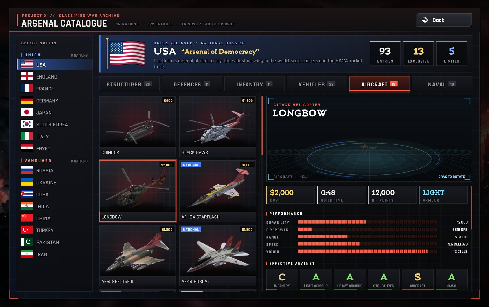</td>
    <td>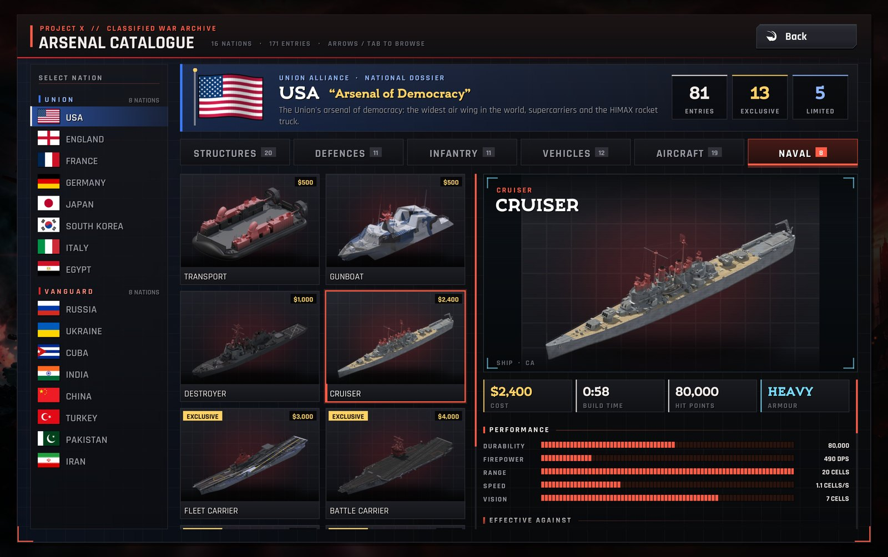</td>
  </tr>
  <tr>
    <td align="center"><sub>Arsenal Catalogue: aircraft</sub></td>
    <td align="center"><sub>Arsenal Catalogue: navy</sub></td>
  </tr>
  <tr>
    <td>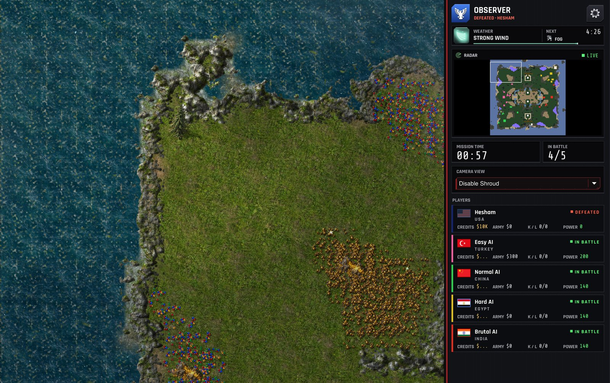</td>
    <td>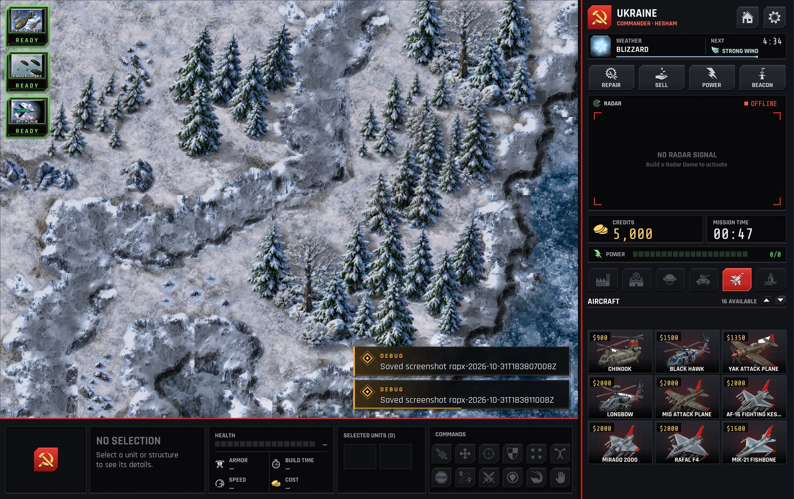</td>
  </tr>
  <tr>
    <td align="center"><sub>Observer view with live stats for every player</sub></td>
    <td align="center"><sub>Battle report</sub></td>
  </tr>
</table>

## 🚩 Choose your side

<table>
  <tr>
    <td align="center" valign="top" width="50%">
      <h3>🔵 The Union</h3>
      
      <br><sub>USA · England · France · Germany · Japan · Korea · Italy · Egypt</sub>
    </td>
    <td align="center" valign="top" width="50%">
      <h3>🔴 The Vanguard</h3>
      
      <br><sub>Russia · Ukraine · Cuba · India · China · Turkey · Pakistan · Iran</sub>
    </td>
  </tr>
</table>

## 🎮 Get in the fight

Skirmish against AI from Easy to Brutal, or play multiplayer with friends on more than 80 maps. Everything the game
needs is in this repository: nothing else to download, no original Red Alert files, no internet connection
required.

### 1. Install the .NET 6 SDK

Download it from [dotnet.microsoft.com](https://dotnet.microsoft.com/download/dotnet/6.0).

Linux only: you also need SDL 2, FreeType, OpenAL and Lua 5.1
(e.g. `sudo apt install libfreetype6 libopenal1 liblua5.1-0 libsdl2-2.0-0`; other distros in
[engine/INSTALL.md](engine/INSTALL.md)).

### 2. Build and launch

**macOS / Linux**

```sh
git clone https://github.com/heshamhabib/rapx.git
cd rapx
make
./launch-game.sh
```

**Windows**

> 📺 **New to this?** [Watch the step-by-step Windows install video](https://heshamhabib.github.io/rapx/#install-video):
> it shows every click, from downloading the game to building it and playing.

```bat
git clone https://github.com/heshamhabib/rapx.git
cd rapx
make.cmd
```

`make.cmd` builds **RAPX.exe** in the folder you cloned into: double click it to play, or pin it to the
taskbar like any other game. (It hands over to a second copy of itself in `enginein`, which is where
OpenRA requires the executable to sit so it can find the mod assemblies next to it.) `launch-game.cmd`
still works if you prefer a console window or want to pass arguments.

On a laptop with switchable graphics, the game asks Windows for the high-performance GPU the first time it
starts: Windows otherwise runs it on the integrated GPU, which costs a lot of frames. The game's
Settings > Display shows which graphics card it is drawing on, and its Graphics Card option changes the choice
(the same per-user setting as Windows Settings > System > Display > Graphics). `make.cmd gpu` sets it by hand.

That's it: the game opens with the cinematic intro, then straight to the main menu.

## 🐞 Pilot version: tell us what you think

You are playing an early build, and every report helps. Found a bug, hit a crash, have an idea for a new unit,
map or nation, or just want to say what you loved or hated? Send an email to
**[heshamhabib5@gmail.com](mailto:heshamhabib5@gmail.com?subject=%5BRAPX%5D%20)** with **`[RAPX]`** at the start of the subject line, so it doesn't get lost.

| Sending a... | Subject example | What helps |
|---|---|---|
| 🐛 **Bug or crash** | `[RAPX] Bug: jets stuck on the airfield` | What you did, what happened, your OS. Screenshots (Ctrl+P in game) and the log files from the OpenRA `Logs` folder (`~/Library/Application Support/OpenRA/Logs` on macOS, `%APPDATA%\OpenRA\Logs` on Windows, `~/.config/openra/Logs` on Linux) help a lot. |
| ⚠️ **Issue** | `[RAPX] Issue: game slow on large maps` | Your PC / Mac specs, the map name and how many players. |
| 💡 **Idea** | `[RAPX] Idea: a Brazilian nation` | As much or as little detail as you like. Sketches welcome. |

<p align="center">
  <a href="mailto:heshamhabib5@gmail.com?subject=%5BRAPX%5D%20"><b>✉️ Email your feedback</b></a>
</p>

---

## License and credits

- RAPX code and data: [GNU AGPL v3](LICENSE).
- The OpenRA engine (`engine/`) and the OpenRA Mod SDK scripts: GNU GPL v3 ([engine/COPYING](engine/COPYING),
  [COPYING](COPYING)). Engine authors are listed in [engine/AUTHORS](engine/AUTHORS).
- Command & Conquer: Red Alert is © Electronic Arts. RAPX contains none of its art, sounds, music or videos: every
  sprite, terrain tile, voice and sound effect is our own or third-party under the licences in
  [mods/rapx/CREDITS](mods/rapx/CREDITS). Terrain tiles and building bibs keep the shapes of the classic templates (where
  grass, cliff and water meet) so existing maps still fit, repainted with our own colours (artsrc/terrain/make_base_tiles.py).
- 3D models, textures and sounds are by their respective authors under Creative Commons and other
  licenses; see [mods/rapx/CREDITS](mods/rapx/CREDITS). A few are licensed **NonCommercial**, so RAPX must not
  be sold.

<p align="center">
  <sub>RAPX is a free fan project and is not affiliated with or endorsed by Electronic Arts or the OpenRA team.</sub>
</p>
